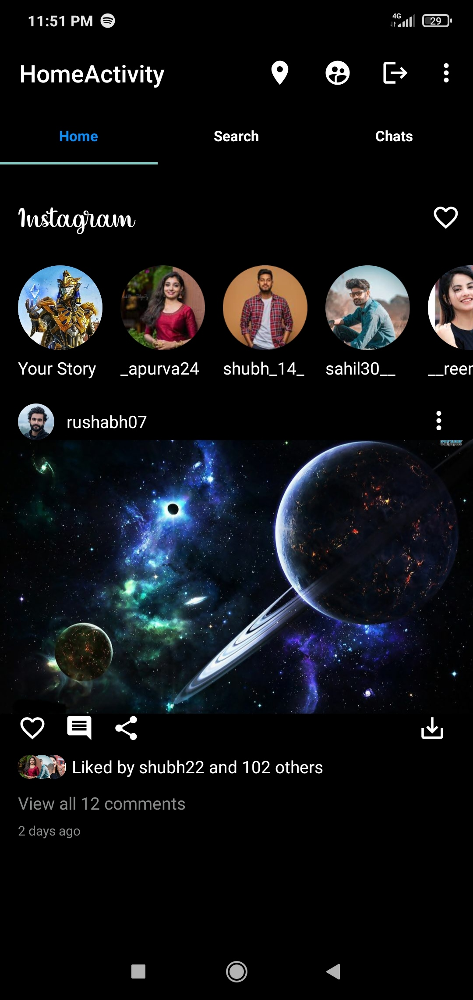
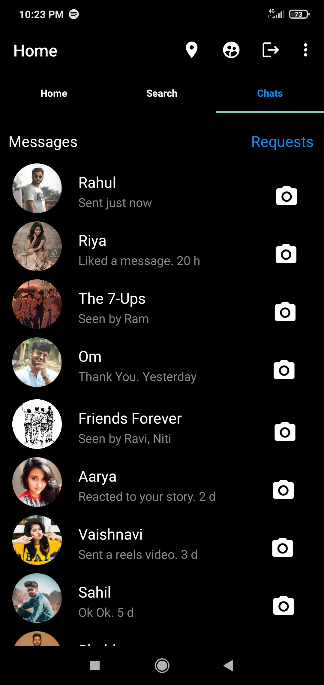
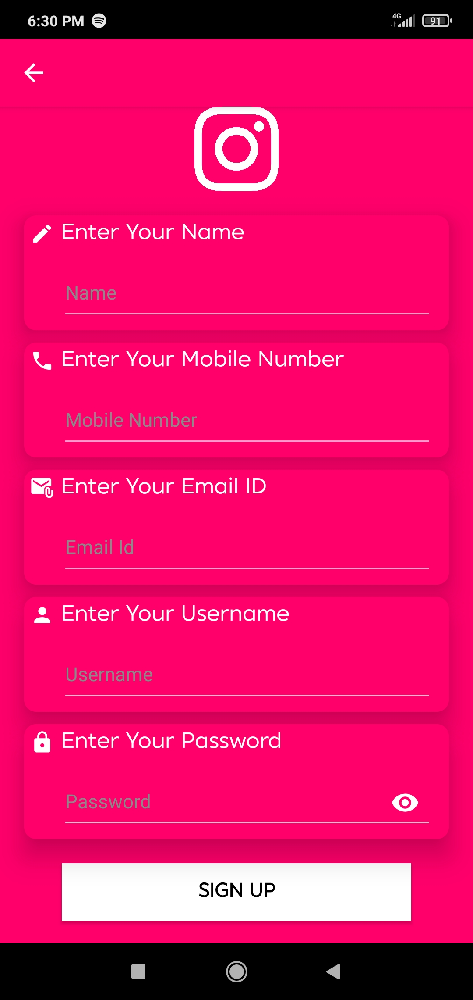

# Instagram Clone App

A pixel-faithful frontend replica of the Instagram Android app, built with Java and Android Studio. Covers the core UI surfaces — feed, profile, post creation, search, and reels — with smooth Fragment-based navigation and Material Design components.

---

## Screenshots

| Home Feed | Chats | Registration |
|-----------|---------|---------------|
|  |  |  |

---

## Tech Stack

| Layer | Technology |
|-------|-----------|
| Language | Java |
| IDE | Android Studio |
| UI Framework | Android XML, Material Design |
| Layout | ConstraintLayout, RecyclerView |
| Navigation | Fragments, Intents |
| Build System | Gradle |

---

## Features

- **Home Feed** — Scrollable post feed with images, likes, comments, and story bar
- **Profile Screen** — Grid-based photo layout with follower/following stats
- **Post Creation Layout** — Full post creation UI with image placeholder and caption input
- **Bottom Navigation** — Fragment-based navigation across Home, Search, Reels, Shop, and Profile
- **Stories Bar** — Horizontal scrollable story avatars using RecyclerView
- **Responsive Design** — ConstraintLayout ensures consistent rendering across screen sizes
- **Material Design** — Follows Material Design guidelines for icons, typography, and spacing

---

## Project Structure

```
app/
├── src/
│   └── main/
│       ├── java/
│       │   └── com/example/instagramclone/
│       │       ├── MainActivity.java
│       │       ├── fragments/
│       │       │   ├── HomeFragment.java
│       │       │   ├── SearchFragment.java
│       │       │   ├── ReelsFragment.java
│       │       │   └── ProfileFragment.java
│       │       └── adapters/
│       │           ├── PostAdapter.java
│       │           └── StoryAdapter.java
│       └── res/
│           ├── layout/       # XML UI layouts
│           ├── drawable/     # Icons and assets
│           └── values/       # Colors, strings, themes
└── build.gradle
```

---

## Getting Started

### Prerequisites

- Android Studio Hedgehog (2023.1.1) or later
- JDK 11+
- Android SDK (API level 21+)
- Gradle 8.x

### Installation

1. **Clone the repository**
   ```bash
   git clone https://github.com/pratikdeoke/Instagram_Clone_App.git
   ```

2. **Open in Android Studio**
   ```
   File → Open → Select the cloned folder
   ```

3. **Sync Gradle**
   ```
   Android Studio will prompt to sync — click "Sync Now"
   ```

4. **Run the app**
   ```
   Select an emulator or connected device → Click ▶ Run
   ```

---

## Architecture

This project follows a **Fragment-based single-Activity architecture**:

```
MainActivity
├── HomeFragment        (Feed with RecyclerView)
├── SearchFragment      (Explore grid)
├── ReelsFragment       (Reels placeholder)
├── ShopFragment        (Shop placeholder)
└── ProfileFragment     (Profile grid with RecyclerView)
```

Navigation between fragments is handled via `BottomNavigationView` with `Intent`-based transitions for detail screens.

---

## Key Implementation Details

- **RecyclerView with Custom Adapters** — Used for both the post feed and horizontal stories bar, with `ViewHolder` pattern for efficient view recycling.
- **ConstraintLayout** — All screens built with ConstraintLayout for flat view hierarchies and responsive rendering across device sizes.
- **Material Design Components** — Uses `MaterialCardView`, `BottomNavigationView`, `FloatingActionButton`, and Material icons throughout.
- **Fragment Lifecycle** — Each tab is an independent Fragment managing its own UI state and RecyclerView adapter.

---

## Limitations

This is a **frontend-only** project. The following are not implemented:
- User authentication
- Backend / database integration
- Real image loading (Glide/Picasso)
- API calls or network requests

---

## What I Learned

- Android Fragment lifecycle and Fragment-to-Fragment communication
- Building efficient list UIs with RecyclerView and custom adapters
- Pixel-accurate UI replication using ConstraintLayout
- Material Design system — spacing, elevation, color tokens, and typography
- Android project structure and Gradle build configuration

---

## License

This project is licensed under the MIT License — see the [LICENSE](LICENSE) file for details.

---

## Author

**Pratik Ravindra Deoke**  
[GitHub](https://github.com/pratikdeoke) · [LinkedIn](https://www.linkedin.com/in/pratikdeoke/)

> ⚠️ This project is built for learning purposes only. Instagram is a trademark of Meta Platforms, Inc. This clone is not affiliated with or endorsed by Instagram or Meta.
